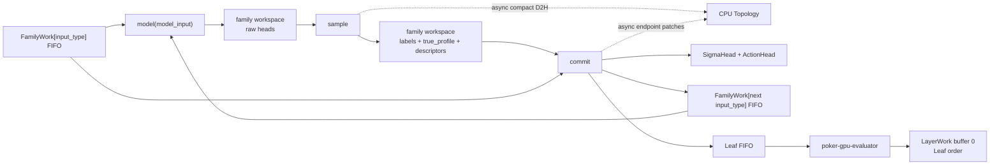

# Queued training rewrite, in iteration order

Status: implementation proposal; not yet an authoritative production contract.

## 1. Fundamentals

### 1.1 One schema, twelve modes

Every allocation is generated from:

```text
training_regime       self_play | best_response
rollout_mode          sequential | branched.fixed | branched.KKT
private_estimator     sampled | rao_blackwell
```

The $2\times3\times2$ mode row determines fields and behavior. Inapplicable fields are absent.

`n_replica >= 1` adds independent model lanes, not a mode axis. Replicas share all schema-affecting configuration,
capacities, estimator, and schedule; weights, loss coefficients, and schema-identical fixed/KKT controller choice and
state are lane-local. Every rank has the same replica IDs and per-ID configuration; `n_replica = 1` is the ordinary
path.

`root_count >= 1` is an independent batch dimension, not a branching degree. Root row $r$ starts one rollout tree
with local distinguished root $(r,\varnothing)$ and its own intrinsic fields.

Sequential mode is the specialization

$$
\beta(\mathsf s)=1
\quad\Longrightarrow\quad
N(\mathsf s)=\widetilde N(\mathsf s)=1
$$

at every node. Branched modes permit $\beta(\mathsf s)\neq1$ and apply the ordinary branching law to each root.
All modes accept any `root_count`. Multiple statistically identical roots are strongly discouraged in branched
mode because branching already creates work; use them when roots differ intrinsically, such as sampled
`true_profile`, stack size, or another model condition.

### 1.2 `input_partition` and `output_partition`

`input_partition` refines `output_partition` on player nodes. An `input_type` selects a model-input schema and FIFO;
an `output_type` selects a numerical target domain. The refinement defines:

```text
output : input_partition -> output_partition
size : input_partition -> int
size : output_partition -> int
```

For poker:

```text
input_partition = {pre}\sqcup{post_A : 2 <= A <= P}
```

Here `post_A` means postflop with $A$ live players. The estimator defines:

```text
sampled                output_partition = {all} with size[all] = 1
rao_blackwell          output_partition = {pre, post} with size[pre] = R^2 and size[post] = 2R(4R-1)
```
We also have a `folded_partition`, which essentially match `output_partition` but is agnostic to `sampled` mode: `folded_partition = {pre, post}`.

### 1.3 Indexing

Each data-structure is indexed by some type of nodes:

- `FamilyWork` is **player-node-indexed**; `SigmaHead` and `SigmaTarget` contain only learner-owned player nodes
- `ActionHead` and `ActionTarget` are **action-indexed**: sequential mode has one action row per learner player node; branched mode has one per target-eligible child
- `Topology` and `LayerPlan` are **structural-node-indexed** as defined in Section 2.2.

`trained` and `learner-owned` are synonymous: every player in self-play, only the exploiter in best response.

### 1.4 Live vs Folded

At a poker node, $A$ `live` players remain eligible; `folded` players take no further actions.

### 1.5 Authority and intentional contract changes

`docs/theory/core_math.tex` remains authoritative for mathematics.
`docs/theory/pseudocode/` must be updated for the root-batch definition, $\beta=1$ sequential geometry, and
branched-RB `true_profile` reuse. Branching and queue-pressure laws, completion, and duplicate-child identity remain.
The root batch intentionally replaces the current one-branched-tree-per-GPU repository convention; update that
convention before implementation.
CPU owns only compact topology and movement plans; numerical work and bulk storage remain on the accelerator.

## 2. Family-based Rollout

All `*_cap` values are fixed run hyperparameters. Each owner uses one aligned SoA arena; every field is contiguous
over rows. In particular, a stable `FamilyWork[input_type]` prefix is a direct model batch.
Schemas below omit the leading replica axis: mutable owner `X <cap,...>` is stored as
`X <n_replica,cap,...>`, and every row reference, tail, RNG state, and failure is lane-local.

Fix `player_node_cap : input_partition -> int`. For each `input_type` and
$0\leq\sigma<\mathtt{player\_node\_cap[input\_type]}$:

```text
FamilyWork[input_type] <player_node_cap[input_type]>
  hot[sigma]
    logical RNG path key
    role selector                          # best_response only: trained or frozen
    true_profile <P>
    folded_range_row <P-A>                 # for A the number of live ranges
    mode-specific controller/path fields
    reservation/publication metadata

  retained[sigma]
    model_input <size[input_type]>
    x_p                                   # sampled only
    owner
```

Fix `trained_player_cap : input_partition -> int`. For each `input_type` and
$0\leq i<\mathtt{trained\_player\_cap[input\_type]}$:

```text
SigmaHead[input_type] <trained_player_cap[input_type]>
  old_v[i] <size[output(input_type)]>
  old_t[i]                                 # branched only
  old_c[i]                                 # branched only
```

Let `action_partition = input_partition` and `action_output = output` in sequential mode. In branched mode,
`action_partition = output_partition` and `action_output` is the identity. Fix
`action_cap : action_partition -> int`. For each `action_type` and
$0\leq a<\mathtt{action\_cap[action\_type]}$:

```text
ActionHead[action_type] <action_cap[action_type]>
  action[a]
  old_log_pi[a] <size[action_output(action_type)]>
```

Let `K_strata` be the width of the evaluator's nested-pot axis. Fix `leaf_cap : int`.
For each $0\leq\tau<\mathtt{leaf\_cap}$, sampled mode stores exactly the batched
row inputs of `evaluate_showdowns`:

```text
Leaf <leaf_cap>                             # sampled
  board_cards[tau] : uint8 <5>
  combo_ids[tau] : int32 <P>
  stratum_level[tau] : int32 <P>
  payoff_baseline[tau] : float32 <P>
  stratum_amount[tau] : float32 <K_strata>
```

For the same row $\tau$, RB mode stores exactly the batched row inputs of `complete`;
best response adds `selected_player[tau]` and calls `complete_selected`:

```text
Leaf <leaf_cap>                             # RB
  board_cards[tau] : uint8 <5>
  range_weights[tau] : float32 <P,H>
  selected_player[tau] : int32             # best_response only
  stratum_level[tau] : int32 <P>
  payoff_baseline[tau] : float32 <P>
  stratum_amount[tau] : float32 <K_strata>
  seed[tau] : int64
```

This is contract v2 from `/home/pablob/poker-gpu-evaluator/docs/api.md`. `n_samples` is call-level configuration,
not a `Leaf` column.

Fix `topology_cap` and `topology_edge_cap`. For each topology row $s$ and child edge $e$:

```text
Topology <topology_cap>
  parent[s]                   # nearest retained ancestor
  child_begin[s]              # into TopologyChild
  N[s]
  N_tilde[s]
  N_tgt[s]
  owner[s]
  familywork_row[s]           # -1 if absent
  sigma_head_row[s]           # -1 if untrained
  action_begin[s]             # -1 if untrained

TopologyChild <topology_edge_cap>
  label[e]                    # action or chance label
  path_length[e]              # original edges represented by this edge
  target_kind[e]              # Topology or Leaf
  target_row[e]
```

For each `folded_type` and folded-range row $f$:

```text
FoldedRanges[folded_type] <folded_range_cap[folded_type]>
  r_pi[f] <width[folded_type]>
```

Here `width[pre] = K` and `width[post] = H`; every `post_A` family shares `FoldedRanges[post]`.

For each `input_type`, queue metadata contains:

```text
QueueBehaviorMetadata <|input_partition|>
  head[input_type]
  ready_tail[input_type]
  reserved_tail[input_type]
  frontier_cost[input_type]                 # safeguard only
  controller_state                          # safeguard only
```

$$
0
\le\mathtt{head[input\_type]}
\le\mathtt{ready\_tail[input\_type]}
\le\mathtt{reserved\_tail[input\_type]}
\le {\tt player\_node\_cap[input\_type]}
$$

`[head,ready_tail)` is committed FIFO work; `[ready_tail,reserved_tail)` is reserved but unpublished.
`[0,head)` remains allocated until `align-and-seal`; indices never wrap or repeat.
When enabled, enqueue and dequeue add and remove the same declared C-head contribution from `frontier_cost`.

### 2.1 Data flow

Every stable family prefix runs `model -> sample -> commit`:



- `model` reads only `model_input` and writes raw heads to the workspace.
- `sample` owns all draws. It writes labels and child `true_profile` rows to workspace and stages a compact CPU
  `Topology` packet.
- `commit` moves the workspace into saved heads, writes all `FamilyWork`/`Leaf` destinations atomically, and queues
  compact endpoint patches. The CPU accepts both only after the transaction's commit marker.

`SigmaHead` copies direct model outputs. `ActionHead` selects the sampled entries of the model action head.
The GPU does not wait for the topology transfer. The policy tensor is never expanded to child shape.

Only one replica-grouped `model + sample` batch runs at once. The scheduler selects one `input_type`, an eligible
lane set, and one common stable-prefix width; model inference is replica-batched and non-autograd kernels flatten
`(replica,row)`. 
In particular, in poker, within a batch, we pad tokens minimally to:
- the largest history in the family batch,
- the earliest street in the family batch (later streets have board-masked hands and thus need less tokens).

Inactive lanes add neither padding nor RNG draws. Commit may overlap the next batch:

```text
model/sample stream:  [model+sample k]       [model+sample k+1]
commit stream:                    [commit k]                  [commit k+1]
```

Degrees, scans, extent totals, and reservations stay on-device. The next batch uses only published queue rows.

### 2.2 Compact topology

During rollout,

$$
\mathtt{Topology}
=\{\text{trained player nodes}\}\cup\{\mathsf s:\widetilde N(\mathsf s)\geq2\}.
$$

In best response, trained player nodes exclude frozen opponents. Non-player nodes satisfy $N=\widetilde N$;
an omitted frozen player also has $\widetilde N=1$. Every omitted node therefore has $N=\widetilde N=1$.
A compressed edge stores `path_length`, preserving unary cost. Frozen best-response opponents
need no head metadata. Endpoint domains determine output conversion. Duplicate labels remain distinct edges.

`sample` stages degrees and labels in logical order. Descendant rows carry unresolved edge handles; later packets or
commit patches close them. Transaction sequence numbers prevent partial topology publication.

### 2.3 Sampling laws

There are three samplers:

1. The root sampler draws one uniform private `true_profile` per root and writes it to `FamilyWork.hot`.
2. Every non-branched-RB node draws action or chance labels from its existing `true_profile`; `commit` copies that
   profile to every non-leaf child.
3. Branched RB uses the rejection kernel below.

In sampled mode, one root uses one joint profile for its whole tree. Sampled branching intentionally correlates
siblings and is an experimental biased mode.

For a branched-RB node $\mathsf s$ with $N(\mathsf s)\geq1$, designate logical child $0$ as the reuse child. For each
logical child $j$:

$$
x_{\mathsf s,0}=\mathtt{true\_profile}[\mathsf s],
\qquad
x_{\mathsf s,j}\sim\mu_{\mathsf s}\ \text{ independently for }1\leq j<N(\mathsf s),
$$

then draw its action or chance label conditional on $x_{\mathsf s,j}$. `commit` writes
$x_{\mathsf s,j}$ as the child's `FamilyWork.hot.true_profile`. A leaf consumes the profile during `commit` and stores
no copy.

Thus an $N$-child expansion rejection-samples only $N-1$ profiles. If $C$ player children enter chance, their $C$
propagated profiles each seed one chance child; each chance parent samples only its remaining children.
The reused action profile has the correct action-conditioned law after conditioning on its sampled action, and the
reused chance profile has the correct board-conditioned law after conditioning on its sampled chance label.

Root rows and RNG keys are fixed before draws. Root batching is independent of rollout mode.
Only branched RB requires posterior-profile rejection; the other modes use their stored `true_profile` and categorical
labels.

Best response selects the learner or frozen model per stable FIFO subspan. Frozen decisions create `FamilyWork`, but
no saved heads or targets; their rows are discarded at `align-and-seal`.

For each root, refill protects its original action prefix and recomputes descendant path masses using its final degree.
Refill-only children have no root action target.

### 2.4 Queues, routing, and fusion

Each family processes its largest feasible stable FIFO prefix; it never skips older rows to reduce padding.
Advancing `head` empties queue work. `FamilyWork.hot` and `FamilyWork.retained` remain allocated until
align-and-seal.
Only declared `input_type` families create queues; street, width, and padding properties do not.

Order candidate lane queues by full before partial, input-type preorder, then greatest `(load, age)` or `(fill, age)`.
The first candidate fixes `input_type`; choose a compatible cohort and its largest feasible common prefix.

`Leaf` is another FIFO. Bounded calls to `evaluate_showdowns`, `complete`, or `complete_selected` write into
`LayerWork`; compatible lane prefixes share an evaluator call, and each consumed `Leaf` row then becomes dead.

Chance closure repeats `sample -> commit` in a bounded device frontier without a host synchronization per generation.

For a one-CTA pack, fuse sampling, destination counts, stable offsets, materialization, and commit when resources
permit. Larger packs use:

```text
sample/descriptors -> stable scan -> reserve -> materialize -> commit
```

Branched-RB rejection sampling, folded-stat construction, transition, classification, and chance closure should
fuse. Showdown and completion stay in `poker-gpu-evaluator`.

Poker stores folded normalized `r_pi` only in `FoldedRanges`: `K`-wide for `pre`, `H`-wide for shared `post`.
`FamilyWork.hot` stores direct references; `model_input` stores compact folded statistics. A completion-bound `pre`
row expands `K -> H` once when materializing `Leaf.range_weights`, because the evaluator API is $H$-native. See
[`poker_folded_statistics.md`](poker_folded_statistics.md) and
[`poker_branched_rb_sample.md`](poker_branched_rb_sample.md).

Commit advances every lane-local destination tail together after all writes and dependencies succeed. A failed lane
advances none; completed lanes keep their stores. Its retry uses a disjoint RNG address and reduces sequential
`root_count`, fixed beta, or KKT controller scale. Caps never change. Recovery at minimum controls fails the run.
Each iteration logs capacity, high-water tail, used rows, overflow extent, retry address, and old/new controls.
Recovered attempts are reported as control changes, not law-equivalent retries.

```text
DeviceFailure
  status
  phase
  failure_code
  input_type
  logical_address
  requested_extent
  available_extent
  sampler_attempt_count
```

Concurrent failures resolve to the minimum logical address per lane; all ranks take the same lane-local boundary
decision.

## 3. Seal and Completion

### 3.1 `LayerWork`

Completion may overlap rollout. For each leaf row $\tau$, buffer `0` first exposes the evaluator's exact output view:

```text
LayerWork.completion <leaf_cap>
  payoff[tau] : float32 <P>                # sampled: evaluate_showdowns
  p_hat[tau] : float32 <P,H>               # RB self_play: complete
  v_hat[tau] : float32 <P,H>
  p_hat[tau] : float32 <H>                 # RB best_response: complete_selected
  v_hat[tau] : float32 <H>
  n_eff[tau] : float32                     # RB
```

The completion epilogue validates `n_eff`, converts `v_hat` in-place to
$m_hat=p_hat*v_hat$, and reduces `m_hat` to vector value. A requested evaluator option may return `m_hat` instead of
`v_hat`, eliminating the multiply and the `v_hat` interpretation without adding a field.

Let `P_train = P` in self-play and `P_train = 1` in best response. For each `output_type`, buffer
$b\in\{0,1\}$, and row $j$, propagation uses:

```text
sampled
  return_value[b,j] <P_train, size[output_type]>

rao_blackwell
  mass[b,j] <P_train, size[output_type]>
  moment[b,j] <P_train, size[output_type]>

branched only
  trace_vector[b,j] <P_train>
  cost[b,j]
  delta[b,j]
```

`return_value` is lambda-bootstrapped; `trace_vector` is not. Cost and delta start at zero.

Logical views share two fixed SoA arenas. Poker's only conversion is `post -> pre`; it sums mass and moment before
conditionalization. [`layered_target_creation.md`](layered_target_creation.md) is the exact work and kernel contract.

For a `pre` leaf, the evaluator first writes its $H$-shaped completion view; the epilogue writes the $K$-shaped
propagation view into the other arena:

$$
(Gz)_k=\sum_{h:c(h)=k}z_h,\qquad
\widehat V_{p,k}
=\operatorname{Cond}\left(\sum_{h:c(h)=k}\widehat M_{p,h},
                           \sum_{h:c(h)=k}\widehat{\mathbb P}_{p,h}\right).
$$

### 3.2 `align-and-seal`

As soon as family/chance queues and topology transfers finish, the CPU computes

$$
L(\sigma)
=1+\max_{e:\sigma\to u}L(u),
\qquad L(\mathtt{Leaf})=0.
$$

Planning is replica-local; target execution later concatenates equal-numbered layers.

Let `layer_count`, `layered_node_count`, `layered_edge_count`, and `carry_count` be the realized exact counts.
Shorter branches carry until their parent layer. The CPU emits the exact `LayerPlan` schema in
[`layered_target_creation.md`](layered_target_creation.md). Frozen best-response rows are deleted; a frozen
$\widetilde N\geq2$ node remains only as a headless structural reduction.

Let `trained_player_count[input_type]` and `trained_action_count[action_type]` be realized exact counts.
Learner head and action indices are final when created. Self-play retained rows already align; best response compacts
only trained inputs.
For each learner player row $i$ and learner action row $a$, allocate aligned targets:

```text
SigmaTarget[input_type] <trained_player_count[input_type]>
  v_lambda_hat[i] <size[output(input_type)]>
  t_hat[i]                                  # branched only
  c_lambda_hat[i]                           # branched only

ActionTarget[action_type] <trained_action_count[action_type]>
  p_hat[a] <size[action_output(action_type)]> # RB only
  a_lambda_hat[a] <size[action_output(action_type)]>
```

Sequential mode stratifies all five arrays by `input_type`. For each sequential learner row $i$, their row order is:

```text
FamilyWork[input_type].retained[i]
SigmaHead[input_type][i]
SigmaTarget[input_type][i]
ActionHead[input_type][i]
ActionTarget[input_type][i]
```

Branched mode aligns `FamilyWork.retained`/`SigmaHead`/`SigmaTarget` by `input_type` and
`ActionHead`/`ActionTarget` by `output_type`. Each sigma row stores its contiguous target-eligible action span.

For each `input_type` and learner row $i$:

```text
LearnerIndex[input_type] <trained_player_count[input_type]>
  action_begin[i]                           # branched only; sequential uses i
  action_count[i]                           # branched only; sequential is 1
  N_tgt[i]
  log_sampling_weight[i]                    # branched only
```

CPU planning, best-response input compaction, and the `LayerPlan` upload may overlap remaining completion. After
completion finishes, permute buffer `0` from `Leaf` order into the initial frontier in buffer `1`.
Delete `FamilyWork.hot`, `Leaf`, `FoldedRanges`, CPU `Topology`, source capacities, and permutation scratch.

The operation is transactional. Admission includes source and destination arrays, both work arenas, bounded scratch,
library workspaces, and a guard:

$$
\max_\phi\left(M_{\mathrm{owners},\phi}+M_{\mathrm{bounded},\phi}
+M_{\mathrm{external},\phi}\right)+M_{\mathrm{guard}}\leq M_{\mathrm{budget}}.
$$

## 4. Target Propagation

[`layered_target_creation.md`](layered_target_creation.md) is the sole target contract:

```text
Leaf completion
  -> initial permutation
  -> one asynchronous CUDA kernel per layer
  -> validation
  -> atomic learner publication
```

One CTA owns one parent or carry row. The host enqueues every layer without synchronization. Sequential mode is the
$N=N_{\rm tgt}=\widetilde N=1$ specialization. Layer $\ell$ combines every replica that has that layer; work,
destinations, reductions, failures, and publication remain lane-local.

## 5. Learner

### 5.1 Sampling

Sequential mode creates one `randperm` per `input_type` and epoch, then chunks it. The same indices gather all five
aligned arrays. Each replica owns its permutations and draws.

For each non-empty branched learner/input stratum $m$ with $D_m$ rows and each $0\leq d<D_m$:

```text
BranchedSampler <|strata|>
  log_Z[m] : float64
  alias_threshold[m] : float64 <D_m>
  alias_index[m] : int32 <D_m>
```

The alias table samples sigma row $d$ with normalized decision mass

$$
\omega_d=\prod_{s\prec d}\frac1{N(s)}.
$$

Root refill uses each root's final degree in descendant masses. Best response contains only learner decisions.
The variance/cost allocator chooses integer statistical sample counts; physical GPU widths do not round them.

### 5.2 Physical batches

Sequential batches need one index vector. Branched batches use:

```text
sigma_index <B>
action_ptr <B+1>
action_index <E>
```

Admission bounds both $B$ and $E$. Gather the aligned sigma arrays and, in branched mode, the aligned action spans.
Run the current model once per sigma, compute the loss, and backward immediately in one bounded workspace.

Each lane invokes this operation through zero-copy parameter and dense FP32-gradient views; replica learning has no
`vmap`, padding, replay pack, summed loss, or adapter. Equal-shape lane operations may overlap on CUDA streams; dense
clipping, AdamW, and collectives may vectorize the lane axis. Replicas advance model versions synchronously.

On BF16-capable CUDA, model compute and large model-facing floating storage use BF16 with FP32 accumulation.
Parameter owners, policy/CDF arithmetic, posterior and target reductions, loss controls, gradients, clipping, and
AdamW state use explicit FP32 contracts.

### 5.3 Loss inputs

```text
model input              FamilyWork.retained.model_input
sampled private state    FamilyWork.retained.x_p
old sigma heads          SigmaHead
sigma targets            SigmaTarget
action + old log policy  ActionHead
advantage + posterior    ActionTarget
```

The sigma RB posterior is the mean of its action posterior rows. Sequential action spans have length one, so every
action reduction is identity. T/C losses use `N_tgt` as the T-validity condition.

There is no action padding, invented safe action, inactive-event evaluation, or `max_actions_per_decision` API.
Fixed-shape learner microbatches are CUDA-graph candidates. Hardware profiles may change pack widths, streams,
fusion, and graph shapes, but not schemas or sampling laws. Release transient gathers after each backward and the
sealed store after the final optimizer step.
