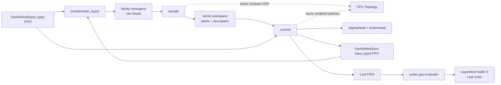
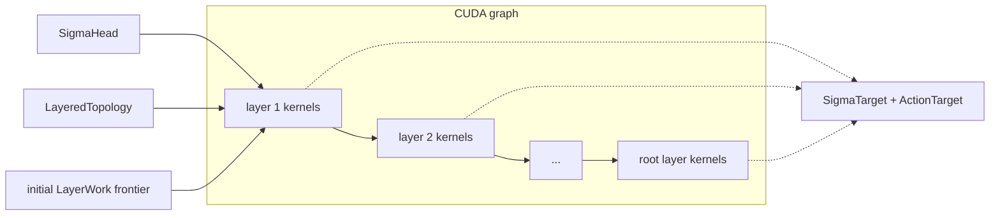

# Queued training rewrite, in iteration order

Status: implementation proposal; not yet an authoritative production contract.

## 1. Fundamentals

### 1.1 One schema, four independent axes

Every allocation is generated from:

```text
training_regime       self_play | best_response
rollout_geometry      sequential | branched
private_estimator     sampled | rao_blackwell
beta_mode             fixed_beta | KKT_beta       # branched only
```

Mode-inapplicable fields shown below are omitted from the generated schema.

### 1.2 `input_partition` and `output_partition`

`input_partition` refines `output_partition` on player nodes. An `input_type` selects a model-input schema and FIFO;
an `output_type` selects a numerical target domain. The refinement defines:

```text
output : input_partition -> output_partition
size : input_partition -> int
size : output_partition -> int
```

For poker:

```text
input_partition = {pre}\sqcup{post_A : 2 <= A <= P}
```

Here `post_A` means postflop with $A$ live players. The estimator defines:

```text
sampled                output_partition = {all} with size[all] = 1
rao_blackwell          output_partition = {pre, post} with size[pre] = R^2 and size[post] = 2R(4R-1)
```

### 1.3 Indexing

Each data-structure is indexed by some type of nodes:

- `FamilyWork` is **player-node-indexed**; `SigmaHead` and `SigmaTarget` contain only learner-owned player nodes
- `ActionHead` and `ActionTarget` are **action-indexed**: sequential mode has one action row per learner player node; branched mode has one per target-eligible child
- `Topology` and `LayeredTopology` are **structural-node-indexed** as defined in Section 2.2.

`trained` and `learner-owned` are synonymous: every player in self-play, only the exploiter in best response.

### 1.4 Live vs Folded

At a poker node, $A$ `live` players remain eligible; `folded` players take no further actions.

### 1.5 Authority and intentional contract changes

`docs/theory/core_math.tex` remains authoritative for mathematics.
`docs/theory/pseudocode/` will have to be updated but we are keeping: branching and queue-pressure laws, sampling laws, completion, and
duplicate-child identity.
CPU owns only compact topology and movement plans; numerical work and bulk storage remain on the accelerator.

## 2. Family-based Rollout

Fix `player_node_cap : input_partition -> int`. For each `input_type` and
$0\leq\sigma<\mathtt{player\_node\_cap[input\_type]}$:

```text
FamilyWork[input_type] <player_node_cap[input_type]>
  hot[sigma]
    logical RNG path key
    role selector                          # best_response only: trained or frozen
    true_profile <P>
    folded_range_row <P-A>                 # for A the number of live ranges
    mode-specific controller/path fields
    reservation/publication metadata

  retained[sigma]
    model_input <size[input_type]>
    x_p                                   # sampled only
    owner
```

Fix `trained_player_cap : input_partition -> int`. For each `input_type` and
$0\leq i<\mathtt{trained\_player\_cap[input\_type]}$:

```text
SigmaHead[input_type] <trained_player_cap[input_type]>
  old_v[i] <size[output(input_type)]>
  old_t[i]                                 # branched only
  old_c[i]                                 # branched only
```

Let `action_partition = input_partition` and `action_output = output` in sequential mode. In branched mode,
`action_partition = output_partition` and `action_output` is the identity. Fix
`action_cap : action_partition -> int`. For each `action_type` and
$0\leq a<\mathtt{action\_cap[action\_type]}$:

```text
ActionHead[action_type] <action_cap[action_type]>
  action[a]
  old_log_pi[a] <size[action_output(action_type)]>
```

Let `K_strata` be the width of the evaluator's nested-pot axis. Fix `leaf_cap : int`.
For each $0\leq\tau<\mathtt{leaf\_cap}$, sampled mode stores exactly the batched
row inputs of `evaluate_showdowns`:

```text
Leaf <leaf_cap>                             # sampled
  board_cards[tau] : uint8 <5>
  combo_ids[tau] : int32 <P>
  stratum_level[tau] : int32 <P>
  payoff_baseline[tau] : float32 <P>
  stratum_amount[tau] : float32 <K_strata>
```

For the same row $\tau$, RB mode stores exactly the batched row inputs of `complete`;
best response adds `selected_player[tau]` and calls `complete_selected`:

```text
Leaf <leaf_cap>                             # RB
  board_cards[tau] : uint8 <5>
  range_weights[tau] : float32 <P,H>
  selected_player[tau] : int32             # best_response only
  stratum_level[tau] : int32 <P>
  payoff_baseline[tau] : float32 <P>
  stratum_amount[tau] : float32 <K_strata>
  seed[tau] : int64
```

This is contract v2 from `/home/pablob/poker-gpu-evaluator/docs/api.md`. `n_samples` is call-level configuration,
not a `Leaf` column.

Fix `topology_cap` and `topology_edge_cap`. For each topology row $s$ and child edge $e$:

```text
Topology <topology_cap>
  parent[s]                   # nearest retained ancestor
  child_begin[s]              # into TopologyChild
  N[s]
  N_tilde[s]
  N_tgt[s]
  owner[s]
  familywork_row[s]           # -1 if absent
  sigma_head_row[s]           # -1 if untrained
  action_begin[s]             # -1 if untrained

TopologyChild <topology_edge_cap>
  label[e]                    # action or chance label
  path_length[e]              # original edges represented by this edge
  target_kind[e]              # Topology or Leaf
  target_row[e]
```

For each `folded_type \in {pre, post}` and folded-range row $f$:

```text
FoldedRanges[folded_type] <folded_range_cap[folded_type]>
  r_pi[f] <width[folded_type]>
```

Here `width[pre] = K` and `width[post] = H`; every `post_A` family shares `FoldedRanges[post]`.

For each `input_type`, queue metadata contains:

```text
QueueBehaviorMetadata <|input_partition|>
  head[input_type]
  ready_tail[input_type]
  reserved_tail[input_type]
  frontier_cost[input_type]                 # safeguard only
  controller_state                          # safeguard only
```

$$
0
\le\mathtt{head[input\_type]}
\le\mathtt{ready\_tail[input\_type]}
\le\mathtt{reserved\_tail[input\_type]}
\le {\tt player\_node\_cap[input\_type]}
$$

`[head,ready_tail)` is committed FIFO work; `[ready_tail,reserved_tail)` is reserved but unpublished.
When enabled, enqueue and dequeue add and remove the same declared C-head contribution from `frontier_cost`.

%%%HERE

### 2.1 Data flow

Every stable family prefix runs `model -> sample -> commit`:



- `model` reads only `model_input` and writes raw heads to the workspace.
- `sample` owns all draws. It writes labels to the workspace and queues their compact CPU `Topology` packet.
- `commit` moves the workspace into saved heads, writes all `FamilyWork`/`Leaf` destinations atomically, and queues
  compact endpoint patches.

`SigmaHead` copies direct model outputs. `ActionHead` selects the sampled entries of the model action head.
The GPU does not wait for the topology transfer. The policy tensor is never expanded to child shape.

### 2.2 Compact topology

During rollout,

$$
\mathtt{Topology}
=\{\text{trained player nodes}\}\cup\{\mathsf s:\widetilde N(\mathsf s)\geq2\}.
$$

In best response, trained player nodes exclude frozen opponents. Non-player nodes satisfy $N=\widetilde N$;
an omitted frozen player also has $\widetilde N=1$. Every omitted node therefore has $N=\widetilde N=1$.
A compressed edge stores its original `path_length`, preserving layer distance and unary cost. Its endpoint domains
determine output conversion. Duplicate sampled labels remain distinct edges.

`sample` publishes degrees and labels in logical order. Descendant family rows carry the unresolved edge handle;
later sample packets or commit endpoint patches close it.

### 2.3 Sampling laws

| Geometry | `sample` |
|---|---|
| sequential | Draw one label. Sampled mode fixes one $x\sim\mu$ per root. |
| branched | Draw $\widetilde N$, the executed $N$, then one labeled child per ordinal. The root uses the same law. |
| branched RB | Also draw one fresh collision-conditioned posterior profile per logical child; discard it after `commit`. |

Sequential roots and RNG keys are fixed before draws; only root multiplicity branches.
Only branched RB requires non-trivial sampling; the other modes need categorical draws and stable labels.
Sampled-branched and branched-best-response sampling still require explicit theory contracts.

Best response selects the learner or frozen model per stable FIFO subspan. Frozen decisions create `FamilyWork`, but
no saved heads or targets.

Root refill protects the original root action prefix. It recomputes descendant path masses using the final degree;
refill-only children have no root action target.

### 2.4 Queues, routing, and fusion

Each family processes its largest feasible stable FIFO prefix; it never skips older rows to reduce padding.
Advancing `head` empties queue work. `FamilyWork.hot` and `FamilyWork.retained` remain allocated until
align-and-seal.
Only declared `input_type` families create queues; street, width, and padding properties do not.

`Leaf` is another FIFO. Bounded calls to `evaluate_showdowns`, `complete`, or `complete_selected` write into
`LayerWork`; the consumed `Leaf` row then becomes dead.

Chance closure repeats `sample -> commit` in a bounded device frontier without a host synchronization per generation.

For a one-CTA pack, fuse sampling, destination counts, stable offsets, materialization, and commit when resources
permit. Larger packs use:

```text
sample/descriptors -> stable scan -> reserve -> materialize -> commit
```

Branched-RB rejection sampling, folded-stat construction, transition, classification, and chance closure should
fuse. Showdown and completion stay in `poker-gpu-evaluator`.
Fixed-address model packs and bounded chance steps are additional CUDA-graph capture units.

Poker stores folded normalized `r_pi` only in `FoldedRanges`: `K`-wide for `pre`, `H`-wide for shared `post`.
`FamilyWork.hot` stores direct references; `model_input` stores compact folded statistics. A completion-bound `pre`
row expands `K -> H` once when materializing `Leaf.range_weights`, because the evaluator API is $H$-native. See
[`poker_folded_statistics.md`](poker_folded_statistics.md) and
[`poker_rejection_chance_closure.md`](poker_rejection_chance_closure.md).

Commit advances every destination tail together after all writes and dependencies succeed. Failure advances none.
Sequential overflow stops; admitted branched overflow may retry only the whole tree with a disjoint RNG address.

```text
DeviceFailure
  status
  phase
  failure_code
  input_type
  logical_address
  requested_extent
  available_extent
  sampler_attempt_count
```

Concurrent failures resolve to the minimum logical address; all ranks take the same boundary decision.

## 3. Seal and Completion

### 3.1 `LayerWork`

Completion may overlap rollout. For each leaf row $\tau$, buffer `0` first exposes the evaluator's exact output view:

```text
LayerWork.completion <leaf_cap>
  payoff[tau] : float32 <P>                # sampled: evaluate_showdowns
  p_hat[tau] : float32 <P,H>               # RB self_play: complete
  v_hat[tau] : float32 <P,H>
  p_hat[tau] : float32 <H>                 # RB best_response: complete_selected
  v_hat[tau] : float32 <H>
  n_eff[tau] : float32                     # RB
```

The completion epilogue validates `n_eff`, converts `v_hat` in-place to
$m_hat=p_hat*v_hat$, and reduces `m_hat` to vector value. A requested evaluator option may return `m_hat` instead of
`v_hat`, eliminating the multiply and the `v_hat` interpretation without adding a field.

Let `P_train = P` in self-play and `P_train = 1` in best response. For each `output_type`, buffer
$b\in\{0,1\}$, and frontier row $j$, propagation uses:

```text
LayerWork[output_type] <2, leaf_cap>
  p_hat[b,j] <P_train, size[output_type]>   # RB only
  m_hat[b,j] <P_train, size[output_type]>   # RB only
  v_vector_hat[b,j] <P_train>
  c_lambda_hat_work[b,j]
  delta[b,j]
```

Sampled `payoff` becomes `v_vector_hat`, selecting the exploiter component in best response. RB completion produces
the remaining fields. Cost and delta start at zero.

`output_partition` declares an upstream conversion DAG. For every edge `early <- late`,
`size[early] <= size[late]`. Logical `LayerWork[output_type]` views share two physical arenas: after the last
consumer of a later row, its wider bytes may back earlier rows. Early rows keep their compact logical shape; only
their backing bytes are reused. Poker uses `pre <- post`.

For a `pre` leaf, the evaluator first writes its $H$-shaped completion view; the epilogue writes the $K$-shaped
propagation view into the other arena. At every `pre <- post` edge, aggregate mass and moment before
conditionalization:

$$
(Gz)_k=\sum_{h:c(h)=k}z_h,\qquad
\widehat V_{p,k}
=\operatorname{Cond}\left(\sum_{h:c(h)=k}\widehat M_{p,h},
                           \sum_{h:c(h)=k}\widehat{\mathbb P}_{p,h}\right).
$$

### 3.2 `align-and-seal`

As soon as family/chance queues and topology transfers finish, the CPU computes

$$
L(\sigma)
=\max_{\tau\text{ terminal below }\sigma}|\tau\setminus\sigma|
=\max_{e:\sigma\to u}\left(\mathtt{path\_length}[e]+L(u)\right),
\qquad L(\mathtt{Leaf})=0.
$$

Let `layer_count`, `layered_node_count`, `layered_edge_count`, and `carry_count` be the realized exact counts.
Shorter branches carry forward until their parent layer is ready. For each layer $\ell$, node $s$, child edge $e$,
and carry row $c$, the CPU emits:

```text
LayeredTopology
  layer_ptr <layer_count+1>
  carry_ptr <layer_count+1>

  node <layered_node_count>
    child_begin[s]
    N[s]
    N_tgt[s]
    N_tilde[s]
    owner[s]
    input_type[s]
    output_type[s]
    destination_work_row[s]
    sigma_head_row[s]                     # -1 if structural
    sigma_target_row[s]                   # -1 if structural
    action_begin[s]                       # -1 if structural

  child <layered_edge_count>
    path_length[e]
    source_work_row[e]

  carry <carry_count>
    output_type[c]
    source_work_row[c]
    destination_work_row[c]
```

Layer $\ell$ owns node rows in `[layer_ptr[ell],layer_ptr[ell+1])` and carry rows in
`[carry_ptr[ell],carry_ptr[ell+1])`. In best response, delete frozen `FamilyWork` rows; any frozen topology row is
already a headless $\widetilde N\geq2$ structural reduction.

Let `trained_player_count[input_type]` and `trained_action_count[action_type]` be realized exact counts.
Stable-compact `FamilyWork.retained` and `SigmaHead` to the player counts and `ActionHead` to the action counts.
For each learner player row $i$ and learner action row $a$, allocate aligned targets:

```text
SigmaTarget[input_type] <trained_player_count[input_type]>
  v_lambda_hat[i] <size[output(input_type)]>
  t_hat[i]                                  # branched only
  c_lambda_hat[i]                           # branched only

ActionTarget[action_type] <trained_action_count[action_type]>
  p_hat[a] <size[action_output(action_type)]> # RB only
  a_lambda_hat[a] <size[action_output(action_type)]>
```

Sequential mode stratifies all five arrays by `input_type`. For each sequential learner row $i$, their row order is:

```text
FamilyWork[input_type].retained[i]
SigmaHead[input_type][i]
SigmaTarget[input_type][i]
ActionHead[input_type][i]
ActionTarget[input_type][i]
```

Branched mode aligns `FamilyWork.retained`/`SigmaHead`/`SigmaTarget` by `input_type` and
`ActionHead`/`ActionTarget` by `output_type`. Each sigma row stores its contiguous target-eligible action span.

For each `input_type` and learner row $i$:

```text
LearnerIndex[input_type] <trained_player_count[input_type]>
  action_begin[i]                           # branched only; sequential uses i
  action_count[i]                           # branched only; sequential is 1
  N_tgt[i]
  log_sampling_weight[i]                    # branched only
```

CPU planning, learner-array copies, and the `LayeredTopology` upload may overlap remaining completion. After
completion finishes, permute buffer `0` from `Leaf` order into the initial frontier in buffer `1`.
Delete `FamilyWork.hot`, `Leaf`, `FoldedRanges`, CPU `Topology`, source capacities, and permutation scratch.

The operation is transactional. Admission includes simultaneous source and exact destination arrays, both
`LayerWork` arenas, bounded scratch, library/graph workspaces, and a guard:

$$
\max_\phi\left(M_{\mathrm{owners},\phi}+M_{\mathrm{bounded},\phi}
+M_{\mathrm{external},\phi}\right)+M_{\mathrm{guard}}\leq M_{\mathrm{budget}}.
$$

## 4. Target Propagation

Target construction is the CUDA graph:



Each layer may use several domain- or degree-specialized kernels. Kernels within a layer are independent; graph edges
encode every dependency on earlier layers.

For each ready parent, the graph:

1. averages child value, cost, delta, and RB mass/moment;
2. applies the edge `path_length` cost offset, the child nominal multiplier, and any `late -> early` conversion;
3. writes the parent's next-frontier `LayerWork` row;
4. at learner player nodes, uses `SigmaHead` to write `SigmaTarget` and the `ActionTarget` span;
5. carries rows whose parent is not ready into the other buffer.

Branched rows implement `BranchedValue` with batched ragged reductions; sequential rows are the one-action
player-only case. `t_hat` exists exactly when `N_tgt>=2`; otherwise `SigmaHead.old_t` supplies $T^*$. Protected
root reductions use the pre-refill target prefix.
Rows with `sigma_head_row = -1` execute only the structural reduction path.

After the root graph completes and targets validate, delete `LayeredTopology` and `LayerWork`. The five learner
arrays and `LearnerIndex` are already sealed; publish them atomically.

## 5. Learner

### 5.1 Sampling

Sequential mode creates one `randperm` per `input_type` and epoch, then chunks it. The same indices gather all five
aligned arrays.

For each non-empty branched learner/input stratum $m$ with $D_m$ rows and each $0\leq d<D_m$:

```text
BranchedSampler <|strata|>
  log_Z[m] : float64
  alias_threshold[m] : float64 <D_m>
  alias_index[m] : int32 <D_m>
```

The alias table samples sigma row $d$ with normalized decision mass

$$
\omega_d=\prod_{s\prec d}\frac1{N(s)}.
$$

Root refill uses the final root degree in descendant masses. Best response contains only learner decisions.
The variance/cost allocator chooses integer statistical sample counts; physical GPU widths do not round them.

### 5.2 Physical batches

Sequential batches need one index vector. Branched batches use:

```text
sigma_index <B>
action_ptr <B+1>
action_index <E>
```

Admission bounds both $B$ and $E$. Gather the aligned sigma arrays and, in branched mode, the aligned action spans.
Run the current model once per sigma, compute the loss, and backward immediately in one bounded workspace.

### 5.3 Loss inputs

```text
model input              FamilyWork.retained.model_input
sampled private state    FamilyWork.retained.x_p
old sigma heads          SigmaHead
sigma targets            SigmaTarget
action + old log policy  ActionHead
advantage + posterior    ActionTarget
```

The sigma RB posterior is the mean of its action posterior rows. Sequential action spans have length one, so every
action reduction is identity. T/C losses use `N_tgt` as the T-validity condition.

There is no action padding, invented safe action, inactive-event evaluation, or `max_actions_per_decision` API.
Fixed-shape learner microbatches are CUDA-graph candidates. Hardware profiles may change pack widths, streams,
fusion, and graph shapes, but not schemas or sampling laws. Release transient gathers after each backward and the
sealed store after the final optimizer step.
